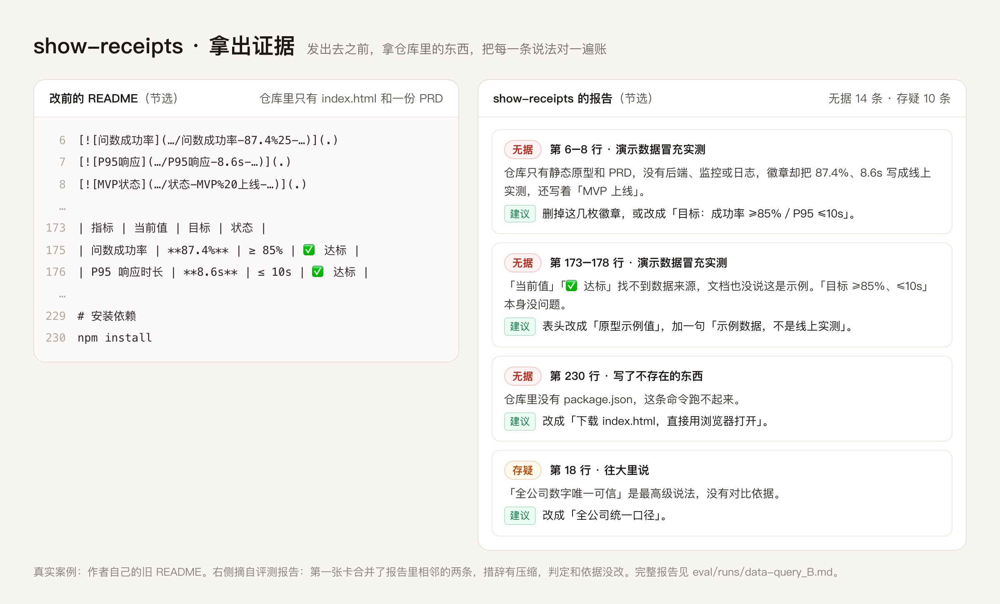

# show-receipts · 拿出证据

**中文** · [English](README.en.md)

> 文档发出去之前，让 AI 拿你手里的材料，把文档里的每一条说法对一遍账。

*A Claude Code skill that audits a README, proposal or report against your own materials before you publish it. Every finding comes with evidence; anything it can't check offline is marked unverified, never "wrong".*



---

## 它解决什么

用 AI 写 README、方案、对外介绍，最常见的毛病是：

- 原型里的示例数字，被写成了「当前值」「已上线」；
- 文档里提到的 `npm install`、`src/` 目录、LICENSE 文件，仓库里根本没有；
- 「据统计」「行业均值」说不出出处；
- 实际两个月，写成了「半年打磨」。

这个 skill 让 AI 在发出去之前，先拿仓库文件、作者底稿、数据表，把这些说法一条条核一遍。

## 它是什么，不是什么

两轮对照评测（见下文）给出的结论很明确：

- **它不会让模型多找出问题。** 评测里的两个模型（Opus、Haiku）不装这个 skill，也能把这类问题找得差不多全。
- **它让报告更聚焦、更可信。**
  - 装了以后，报告里九成左右的条目都是「说法和证据对不上」的问题，不装时只有七成左右。剩下的多是设计点评、措辞润色、领域建议。
  - 每一条都写明证据在哪个文件、哪一行，分「有据／存疑／无据」三档。
  - 不联网就核不了的外部事实，一律标「存疑」，不会凭模型自己的记忆就判你写错了。

如果你想要一份「什么都管」的全面评审，不装它更好。如果你要的是发布前那一遍「这些话站得住吗」，它更合适。

## 查哪六类

| 类别 | 例子 |
|---|---|
| 演示数据冒充实测 | 「当前值」「已上线」「用户规模」，其实只是原型里的示例 |
| 写了不存在的东西 | 文件、目录、命令、链接、许可证，仓库里找不到 |
| 数字和引用没有出处 | 「据统计」「研究表明」，材料里找不到来源 |
| 往大里说 | 时长、规模被放大；「首个」「唯一」「没有之一」 |
| 能力越界 | 写着「支持 X」，代码和底稿里都没有 |
| 前后对不上 | 同一个数字两处写得不一样，或者和底稿对不上 |

判定细则在 [references/categories.md](references/categories.md)，降档改写的对照表在 [references/rewrites.md](references/rewrites.md)。

## 报告长什么样

下面是一段真实输出，来自评测里的一个案例：一份「AI 问数平台」原型的 README，仓库里只有一个 HTML 和一份 PRD。

```markdown
## 结论
改完再发：无据 14 条，存疑 10 条，范围外 2 条。核心问题是仓库只有一个 HTML 原型和一份 PRD，
README 却写成了「已上线、有实测指标、可 npm 运行、有完整 src 代码、SQL 层强制拦截」的真系统。

## 必须改（无据）
2. 第 6–7 行，类别：演示数据冒充实测
   - 原文：徽章「问数成功率-87.4%」「P95响应-8.6s」
   - 问题：仓库只有静态原型和 PRD，没有后端、监控或日志，徽章却把这两个数写成线上实测。
   - 建议改成：删掉这两枚徽章；要保留就改为「目标：成功率 ≥85%／P95 ≤10s」。
```

完整报告见 [eval/runs/data-query_B.md](eval/runs/data-query_B.md)。这个案例是作者自己的旧 README，改前和改后的版本都在 [examples/data-query/](examples/data-query/)。

## 安装

在 Claude Code 里，把这个仓库放进个人的 skills 目录：

```bash
git clone https://github.com/panglezym/show-receipts ~/.claude/skills/show-receipts
```

也可以只放进某个项目：放到项目里的 `.claude/skills/show-receipts/`。

检查脚本只用 Python 标准库，在 Python 3.9 上测过。

## 怎么用

在 Claude Code 里直接说：

- 「这份 README 发之前帮我查一下」
- 「有没有瞎写的？这些数字站得住吗？」

最好同时告诉它材料在哪：仓库目录、底稿、数据表。没给材料也能跑，但报告会写明「没有材料可核」，多数条目会判成存疑。

只想跑机械检查（路径、命令依赖、许可证、前后数字），不用模型：

```bash
python3 scripts/check.py README.md --root .
```

有找不到的路径时，退出码为 1，可以放进 CI。

## 评测

两轮都是对照臂：同一份文档、同一个模型、同一句要求，一组装 skill，一组不装，再和事先冻结的标准答案对比。

| | 第 1 轮 | 第 2 轮 |
|---|---|---|
| 模型 | Opus | Haiku |
| 案例 | 3 份真实 README 的改前版本 | 上面 3 份，加 3 份新出的、埋好问题的虚构项目 README |
| 核心问题召回 | 不装 20／20，装了 20／20 | 不装 49／50，装了 50／50 |
| 范围内占比 | 不装约 70%，装了约 90% | 不装 72%，装了 91% |
| 把核不动的外部事实判成「必须改」 | 不装 1 次，装了 0 次 | 两组都是 0 次 |
| 把有据的干扰项判错 | 没测 | 两组都是 0 次 |
| 代价 | 耗时多约两成 | 耗时多约五成，token 多约两成 |

第 2 轮事先写好了预注册：召回要比不装高 10 个百分点才算「找得更多」。结果只高了 2 个百分点，所以这里**不宣称**它能找到更多问题。

**局限，照实说：**

- 每个案例每组只跑了 1 次，样本小。
- 第 1 轮的六类问题本身就是从那三个案例里总结出来的，属于样本内测试。
- 新案例由另一个模型出题，风格未必和真实世界的文档一样。
- 计分人只有一个，也是 skill 的作者这一方。逐条判定都公开了，可以复核。
- 评测里，子代理是照着 SKILL.md 手动执行流程的，没有测过 Claude Code 自动触发这个 skill 的效果。

完整记录、标准答案和 18 份原始报告都在 [eval/](eval/)。两轮评测都是在 0.1.0 上做的，之后的改动见 [CHANGELOG.md](CHANGELOG.md)。

## 仓库里有什么

```
.
├── SKILL.md              # skill 本体：触发条件、流程、报告格式
├── references/
│   ├── categories.md     # 六类问题的判定细则
│   └── rewrites.md       # 降档改写对照表
├── scripts/
│   └── check.py          # 机械检查，只用标准库
├── examples/             # 3 个真实案例的改前、改后版本和文件清单
├── eval/                 # 两轮评测的设计、答案、原始报告、结果
├── assets/compare.png    # 本页开头的对照图
├── CHANGELOG.md
├── LICENSE
├── README.md
└── README.en.md
```

## License

[MIT](LICENSE) · © 2026 赵永明

---

作者：赵永明
